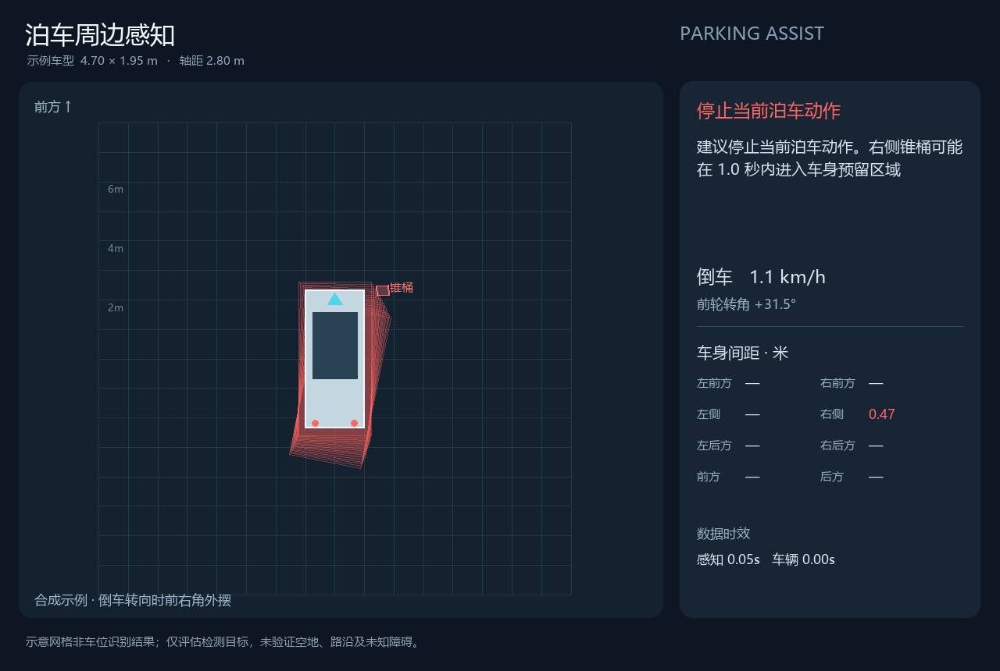
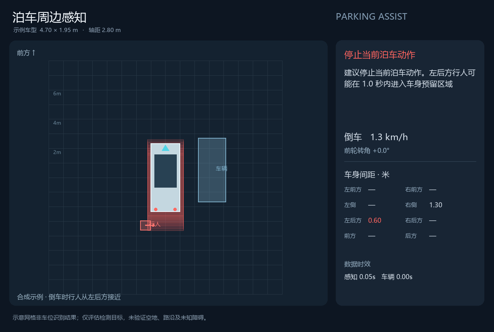
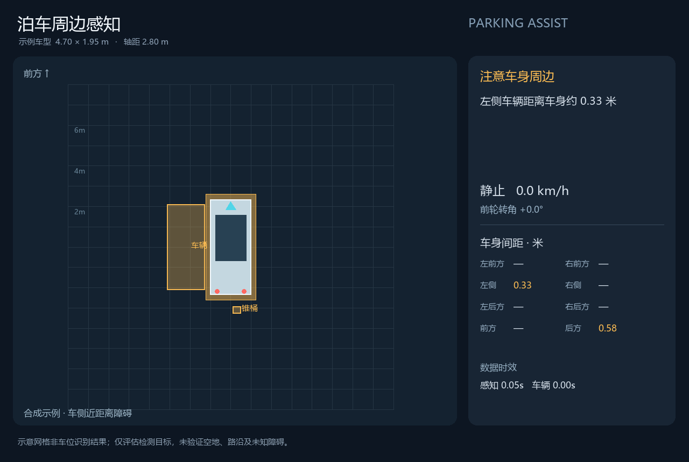
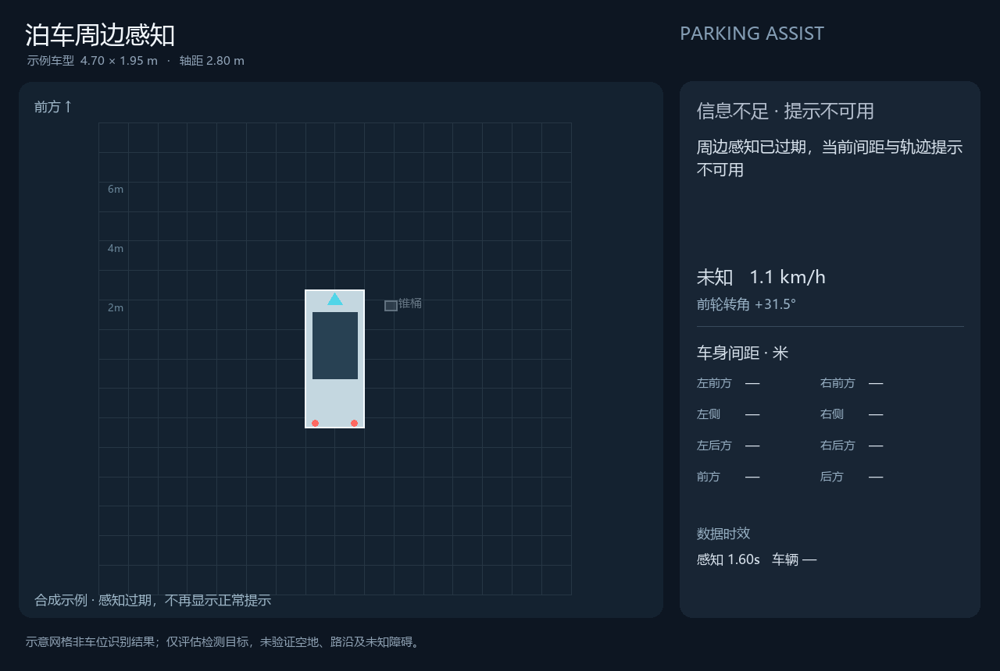

# 停车周边感知与风险提示

此版本把项目的感知和跟踪结果用于停车时的车身间距与扫掠区域提示。车型先使用
用户选择的可配置示例参数，演示场景为合成数据。ROS 节点可以接已有 AsyncBEV
输出及实测车辆反馈；目前未接真实车辆。

## GitHub 预览

[查看四种合成停车场景的视频](videos/parking-assistance.mp4)。以下画面不是实车测试：



| 倒车行人接近 | 车侧间距 | 感知过期 |
| --- | --- | --- |
|  |  |  |

代码、示例媒体与验证摘要均随仓库提交，详细输出日志仍保存在本机 `output/`。
[公开验证摘要](validation/2026-10-31-upgrade.json)。

## 示例车型与坐标

参数文件：`configs/parking_assistance.yaml`。

| 参数 | 示例值 |
| --- | --- |
| 车长 / 车宽 | 4.70 / 1.95 m |
| 轴距 | 2.80 m |
| 后轴中心相对车身中心的 x | -1.35 m |
| 车身预留距离 | 0.25 m |
| 预测时间 | 3 s |
| 当前车身间距提示 | 留意 0.80 m、注意 0.45 m、建议停止 0.15 m |
| 当前示例模型速度上限 | 1.40 m/s，约 5 km/h |

这些是示例模型参数，不是经过实车验证的距离或速度标准。

停车坐标原点必须位于**车身矩形的中心**，x 向前、y 向左、z 向上。`rear_axle_x_m`
是后轴相对这个中心的位置。若实际 `base_link` 位于后轴，不能直接套用示例；
应提供车身中心坐标系（例如 `parking_body_center`）的正确 TF，并把停车节点的
`ego_frame` 和车辆反馈 header.frame_id 改为这个坐标系。

车速按后轴中心计量，负数表示倒车。转角单位为弧度，表示前轴中心的等效前轮
转角，正数向左，**不是方向盘转角**。接口采用 AckermannDrive 的几何约定：
<https://github.com/ros-drivers/ackermann_msgs/blob/ros2/msg/AckermannDrive.msg>。

## 已实现

- 根据车长、车宽、轴距、后轴位置、车速与前轮转角，使用平面自行车模型预测
  车身运动。正向与倒车都保留前后悬的扫掠区域。
- 每个时刻用旋转矩形表示车身和目标。间距是两者轮廓的最短距离，不是目标中心
  到自车中心的距离。通过分离轴检查重叠，并计算顶点到边的距离。
- 输出前、后、左、右和四个角方向的最近目标间距，未有观测的方向显示“—”。
- 将目标的常速度预测与车身轨迹进行同一时刻比较，提示可能进入预留区域的时间。
- 新目标标记为待确认；运动未知的目标不虚构其速度。近距离目标仍会产生间距提示。
- 丢失过久、置信度不足的目标不继续当作有效观测。全部目标不可靠时报告信息不足。
- 感知、车辆反馈过期，或 TF、输入时间戳异常时，报告 `unknown` 并清除未来轨迹。
- 独立 ROS 停车节点按默认 10 Hz 检查输入，即使重模型没有新结果，也会切换过期状态。
- 输出中文泊车画面、结构化报告、文字提示和 RViz 车身预留区域。

没有发生目标框冲突时，状态为 `no_conflict_detected`，而不是可通行或车位可用。
所有报告都带有 `coverage: detected_objects_only` 和 `free_space_verified: false`。
该模块没有从图像识别停车线、车位、路沿或未知小障碍；也没有把空白检测结果当作空地。

## 运行合成演示

在项目根目录，PowerShell：

```powershell
.\.venv\Scripts\python.exe scripts\demo_parking_assistance.py
```

输出：

- `output/parking_assistance/parking_assistance.mp4`：四种停车场景。
- `reverse_pedestrian.png`：倒车时行人从左后方接近。
- `turning_corner.png`：倒车转向时前右角外摆。
- `side_clearance.png`：与旁边车辆的车身间距。
- `stale_perception.png`：过期状态，没有正常间距或未来轨迹。
- `report.json`：各帧几何与提示明细，标明 `synthetic_inputs: true`。

修改车型后可运行单个场景：

```powershell
.\.venv\Scripts\python.exe scripts\demo_parking_assistance.py `
  --config configs\parking_assistance.yaml --scenario turning_corner
```

画面依赖 Pillow。中文字体会优先查找 Windows 微软雅黑或 Linux Noto/WenQuanYi。
这些字体不随仓库分发。参考网格不是车位识别结果。

## ROS 2 接线与启动

沿用 `docs/ASYNCBEV_ROS2.md` 中的模型与 ROS 环境。补充依赖并重新构建：

```bash
sudo apt-get install --no-install-recommends ros-humble-ackermann-msgs python3-pil
source /opt/ros/humble/setup.bash
cd /mnt/d/my_project/multi-camera-lidar-bev-perception/ros2
colcon build --symlink-install --packages-select parking_bev_ros
source install/setup.bash
export PYTHONPATH=/mnt/d/my_project/multi-camera-lidar-bev-perception/src:$PYTHONPATH
```

AsyncBEV 感知节点现在还会发布 `/parking_bev/track_states`。其 JSON 快照包含固定
坐标系中的位置、尺寸、朝向、速度、跟踪 ID、命中次数和距离最后观测的时间。
现有 `/parking_bev/tracks` 标准消息接口继续保留。

启动停车节点：

```bash
ros2 launch parking_bev_ros parking.launch.py \
  profile_config:=/mnt/d/my_project/multi-camera-lidar-bev-perception/configs/parking_assistance.yaml
```

本节点不需要 GPU 模型进程。它接收：

| Topic | 类型 | 内容 |
| --- | --- | --- |
| `/parking_bev/track_states` | `std_msgs/String` | schema_version=1 的跟踪快照 |
| `/vehicle/measured_drive` | `ackermann_msgs/AckermannDriveStamped` | 通过适配器填入实测车速与等效前轮转角 |
| `/tf`、`/tf_static` | TF | 跟踪坐标系到当前车身中心的位姿 |

`AckermannDriveStamped` 常被用作控制指令，本项目只借用字段和几何约定来承载
**实测反馈**。默认不订阅控制指令 topic；实际车辆应由 CAN/底盘反馈适配器填入
当前测量值。不能拿目标车速、目标转角当作已实现的运动状态。

停车节点先检查时间，再把目标按其速度补偿到当前时刻，通过 tf2 转换到当前自车
坐标，最后计算未来车身区域。既补偿对象运动，也补偿自车位姿变化，不重复补偿。

发布：

| Topic | 类型 | 用途 |
| --- | --- | --- |
| `/parking_assistance/report` | `std_msgs/String` | JSON 状态、八方向间距、目标提示、时间与预留区域 |
| `/parking_assistance/advisory` | `std_msgs/String` | 中文提示 |
| `/parking_assistance/swept_path` | `visualization_msgs/MarkerArray` | RViz 车身预留区域，过期时清除 |
| `/parking_assistance/image` | `sensor_msgs/Image` | 中文停车 BEV 画面 |

ROS topic 与刷新参数位于 `ros2/parking_bev_ros/config/parking.yaml`。车型和阈值由
`profile_config` 读取；也可以通过 `vehicle.*` 与 `parking.*` ROS 参数覆盖。回放
bag 时使用统一 `/clock`，将两个节点都设置 `use_sim_time:=true`。

## 数据时效与当前限制

默认感知最大年龄为 0.5 s，车辆反馈最大年龄为 0.3 s。它们是本示例的门限，不是
认证标准。当前 RTX 4070 上的 AsyncBEV 完整链路曾测得 1.4～1.9 s，因此它的
结果进入本停车节点时会变成 `stale_perception`。这反映当前部署还不能提供及时的
停车风险提示；本次没有通过放宽门限把过期输入显示成正常结果。

算法按短时匀速和固定转角预测，基于平面车身矩形，不包含坡度动力学、铰接车体、
逐点扫描去畸变或目标运动不确定性模型。合成示例证明功能路径，不代表真实车辆
的漏检率、碰撞率或可用停车速度。示例参数必须按目标车辆与传感器标定替换。

## 验证

```powershell
.\.venv\Scripts\python.exe -m pytest -q
```

Ubuntu 22.04 / Humble，不需要 GPU 的真实 ROS 发布/订阅检查：

```bash
bash integrations/asyncbev/ros_python.sh scripts/smoke_parking_ros2.py \
  --output-dir output/parking_assistance
```

它使用合成对象、车辆反馈和 TF，检查转向区域、车身间距、感知过期、车辆反馈过期、
异常输入，以及 ROS 图像与 Marker 发布。报告保存为 `ros_parking_smoke.json`。

模型服务启动后，还可以检查真实 AsyncBEV 输出与停车节点的集成：

```bash
bash integrations/asyncbev/ros_python.sh scripts/smoke_ros2.py \
  --packet output/asyncbev/packet_000.npz --with-parking \
  --report output/parking_assistance/ros_model_integration.json
```

该检查重放一个记录的传感器样本；要求真实模型的跟踪快照能被停车节点接收，并且
当前较慢的输出被标记为过期。它不模拟实测车辆反馈，也不证明真实停车可用性。

### 2026-10-31 本机验证结果

- 57 项 pytest 通过，包含前进/倒车、左右转镜像、前角外摆、旋转矩形间距、
  动态行人、车型变化、过期状态和对象/自车运动补偿。
- 四个合成停车场景成功生成中文 PNG、MP4 和逐帧报告。
- Ubuntu 22.04 / Humble 的 colcon 构建与停车节点实际发布/订阅检查通过。
  ROS 检查收到 14 份状态报告、4 帧图像，五种状态检查全部通过。
- 真实 AsyncBEV 集成检查收到 2 组检测、跟踪和含速度的 track_states；每组检测
  84 个目标。停车节点实际接收这些快照，并报告 `stale_perception`。
  本次输入到输出延迟约 1.72 / 1.55 s，感知诊断无 ERROR。
- 实测侧向合成示例输出车身间距约 0.325 m；感知过期后清除了扫掠区域。

测试报告为 `output/parking_assistance/ros_parking_smoke.json` 和
`output/parking_assistance/ros_model_integration.json`。临时 GPU 模型服务在测试
结束后停止，不常驻占用显存。所有实车性能、标定与现场误差尚待验证。
