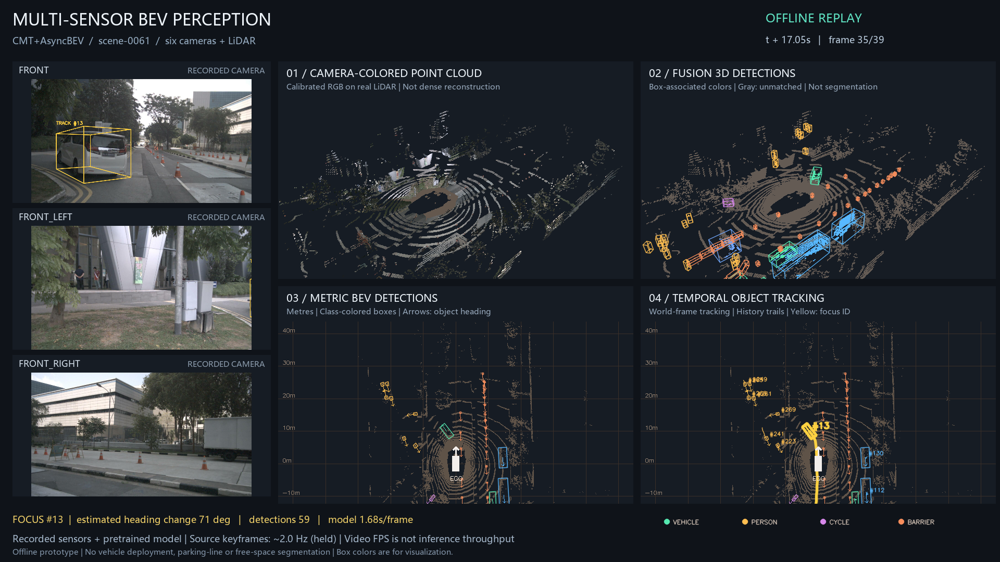

# 多画面感知展示：真实相机、点云、检测与跟踪

面向面试与项目演示的离线回放，画面由真实 nuScenes 传感器和 CMT + AsyncBEV
预训练模型输出生成。左侧三路相机，右侧四个面板使用同一个 sample token。
本展示不启动 ROS，也不代表实车部署或实时推理。
导出的图片和视频使用全英文标题、说明、图例和状态文字，适合英文面试展示。



[查看 19.6 秒 H.264 视频](videos/perception-showcase.mp4)。
README 首页另有自动循环的 GIF 预览，可直接查看多画面对照；GIF 帧率为展示导出设置。

## 各面板表达什么

| 位置 | 内容 | 解释范围 |
|---|---|---|
| 左侧 | 前、左前、右前三路记录相机 | 模型实际输入中的三个视角；总输入为六路相机 |
| 右上区域左侧 | 相机 RGB 投影到真实 LiDAR 点 | 使用标定和不同曝光时刻的自车位姿；属于点云着色，不是稠密重建 |
| 右上区域右侧 | 三维检测框与框内点着色 | 颜色根据预测框类别赋予；未关联点为灰色，不是逐点语义分割 |
| 右下区域左侧 | 米制 BEV 检测 | 自车 x 向前、y 向左；箭头为框朝向 |
| 右下区域右侧 | 目标 ID 与历史轨迹 | 在固定世界坐标系跟踪，再转换回当前自车坐标显示 |

黄色标记对应同一辆白色车辆的 `#13`。脚本从预测结果中离线选择具有运动和
世界坐标朝向变化的车辆作为展示目标；选择窗口内预测朝向变化约 71°。
它是展示用的候选筛选，不是训练得到的转向意图识别器，也不是真值转向标签。
相机框为跟踪三维框通过标定投影的结果。

## 本次生成结果（2026-11-02）

- 场景：`scene-0061`，含路口左转和跟随车辆。
- 真实 GPU 推理：39 个关键帧；单帧模型平均 1.352 秒，P95 2.065 秒。
  此计时不含全部数据读取、预处理或 ROS 链路，不是端到端耗时。
- 图像：1920 × 1080；视频：H.264、10 fps、196 帧、19.6 秒。
- 记录关键帧约 2 Hz；视频逐帧保持显示，不插值。10 fps 是文件帧率。
- 展示阈值：score ≥ 0.35，并按类别检测范围筛选。
- 点云显示最多约 0.16 秒历史，使用自车位姿补偿；不做目标级历史点运动补偿。
  RGB 颜色不保证经过完整遮挡处理，动态物体附近可能存在重影。
- 使用同一时间的 LiDAR 输入，未进行延迟补偿消融或与 BEVFusion 的精度对比。
- 不使用标注框绘图或筛选展示目标；未对整个场景评估 mAP/NDS 或跟踪指标。

详细的逐帧时间、数量与展示约定见 [生成摘要](validation/2026-11-02-showcase.json)。

## 复现

先按照 [模型部署说明](ASYNCBEV_ROS2.md) 准备环境、权重和 nuScenes mini。

在本机 WSL Ubuntu 20.04 的 Bash 里运行真实模型：

```bash
cd /mnt/d/my_project/multi-camera-lidar-bev-perception
bash integrations/asyncbev/model_python.sh /home/yan/micromamba/envs/asyncbev \
  scripts/run_asyncbev_nuscenes.py --scene-index 0 --max-frames 40 \
  --output output/showcase/asyncbev/scene.json
```

这个场景实际有 39 个关键帧。脚本还会写出 NPZ 传感器包，作为可视化中的历史
点云来源；数据和权重保持在 Git 忽略的目录中。

在 Windows PowerShell 中渲染（已有 `.venv` 和项目数据集依赖）：

```powershell
cd D:\my_project\multi-camera-lidar-bev-perception
.\.venv\Scripts\python.exe -m pip install imageio-ffmpeg
.\.venv\Scripts\python.exe scripts\render_perception_showcase.py --h264 --screenshot-frame 34
```

输出位于 `output/showcase/`：

- `perception_showcase.mp4`：完整对照视频。
- `perception_showcase.png`：指定关键帧封面。
- `perception_showcase_first.png`：首帧检查图。
- `report.json`：关键帧时间、点数、目标数量、模型耗时和展示说明。

省略 `--h264` 时使用 OpenCV MPEG-4 Part 2，不需要 `imageio-ffmpeg`。
使用 `--max-frames 3` 可以快速检查布局，但短片段可能没有满足转向条件的目标；
此时脚本退回到普通车辆跟踪高亮，不会声称检测到了转向。

## 面试讲解示例

> 左侧是车辆采集的相机画面，右侧依次展示彩色点云、融合三维检测、米制 BEV 和
> 多目标跟踪。黄色框在相机和 BEV 中对应同一个跟踪 ID，可以观察这辆车转向时
> 的朝向和历史轨迹变化。这里使用真实记录输入与预训练模型输出，属于离线回放。
> ROS 2 接口另有独立节点和发布订阅验证；此视频本身不作为 ROS 或实时性证据。
